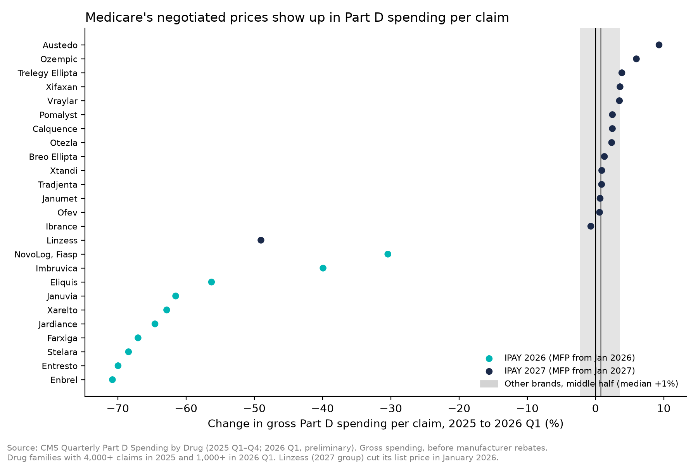
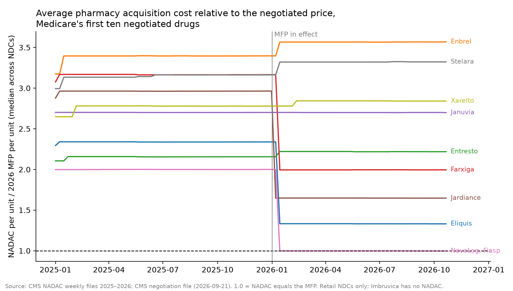

# Medicare drug price negotiation, first year: what moved in January 2026

Status: draft, 2026-10-20. Descriptive analysis. Codex (GPT-6 Astra) replicated every number blind and its fixes are applied (verdict PASS WITH FIXES, `reviews/pharma_ira_codex_astra/report.md`); Agy (Gemini 4 Argon) method review pending. Numbers come from `pharma/scripts/ira_analysis.py`; tables in [outputs/ira/summary.md](outputs/ira/summary.md).

## Question

The first ten Maximum Fair Prices (MFPs) negotiated under the Inflation Reduction Act took effect on 2026-01-01 for Medicare Part D. Three public CMS sources show what changed, from three angles:

| Angle | Source | Measure |
|---|---|---|
| What Part D records as spent | Quarterly Part D Spending by Drug (2025 full year; 2026 Q1, preliminary) | Gross spending per claim |
| What manufacturers list | NADAC Comparison rows whose reason is a WAC adjustment | January WAC-related NADAC cuts and increases, by NDC |
| What pharmacies pay on invoice | NADAC weekly files 2024–2026, joined by NDC to the CMS MFP file | NADAC per unit divided by MFP per unit |

Comparison groups: the 15 drugs negotiated for 2027 (MFP from 2027-01-01), the 15 selected for negotiation for 2028 (prices not yet published), and other brand-name products.

## Findings

**1. Part D gross spending per claim fell by about two thirds for all ten negotiated drugs, while the comparison groups barely moved.** Between 2025 and 2026 Q1 the median change across the ten was −64% (range −30% for NovoLog and Fiasp to −71% for Enbrel; pooled across the ten, −62%), and every one fell by 30% or more. Drugs negotiated for 2027 changed by a median +2.4%, those selected for 2028 by +1.7%, and 831 other brand-name products by +0.8% (middle half −2.3% to +3.6%). About 1% of other brands fell by 30% or more. The one large drop in the 2027 group, Linzess (−49%), coincides with a 50% WAC-related NADAC cut on 2026-01-01.

This is what the payment rules would produce: for a selected drug, the law caps the Part D negotiated price at the MFP plus dispensing fees ([SSA §1860D-2(d)(1)(D), added by Pub. L. 117-169](https://www.govinfo.gov/content/pkg/PLAW-117publ169/html/PLAW-117publ169.htm)), and gross drug cost in this file is built from those claim amounts. The aggregate data are consistent with MFP-based payment; they do not prove it for every claim or separate it from other changes.

**2. On the day the MFPs began, several of the negotiated drugs also took large WAC-related cuts in NADAC.** NADAC records WAC-based cuts effective 2026-01-01 of 43% for Eliquis, 44% for Jardiance, 37% for Farxiga and 75% for Fiasp (the CMS NovoLog entry covers NovoLog and Fiasp; NovoLog itself had been cut 75% on 2024-01-01). In January 2026, 30% of brand NDCs of the 2026 drugs had such a cut of 20% or more, against 1.5% of other brand NDCs, and 19% had any WAC-related increase, against 38% of other brands. Januvia (and Janumet, a 2027 drug) had already been cut 42% on 2025-01-01. Large January cuts among other brand NDCs were uncommon in each year checked (3.6% in 2024, 0.2% in 2025, 1.5% in 2026). These are changes in NADAC that CMS attributes to WAC changes (brand NADAC rates follow published-price changes and are later checked against surveys), not a separate WAC series, and NDCs are not independent manufacturer decisions.

**3. NADAC remains well above the MFP for most of these drugs.** NADAC, the average invoice cost of retail community pharmacies, was 2.0 to 3.4 times the 2026 MFP per unit at the end of December 2025. By October 2026 it was 1.33 for Eliquis, 1.65 for Jardiance and 1.99 for Farxiga, while Januvia (2.70), Xarelto (2.84), Entresto (2.22), Stelara (3.32) and Enbrel (3.57) were essentially unchanged (same results on NDCs present in both snapshots). Insulin aspart needs product-level reading: NovoLog brand NDCs were already at the MFP (ratio 1.0) in December 2025 after their 2024 cut; Fiasp went from about 4.0 to 1.0 with its January 2026 cut; Novo Nordisk's unbranded insulin aspart stays at 2.0 times its own MFP, which CMS sets at about half the NovoLog MFP per unit. The family median (2.0 to 1.0) is a mix of these. This is a gap between an invoice benchmark and the MFP. CMS lets manufacturers effectuate the MFP prospectively or through retrospective refunds, by default computed as WAC minus MFP, with the Medicare Transaction Facilitator exchanging claim data ([CMS final guidance, sections 40.4 to 40.4.4](https://www.cms.gov/files/document/ipay-2028-final-guidance.pdf)). Where refunds apply, a gap like this is what dispensing pharmacies wait to recover; the data here do not show actual pharmacy losses, refund timing or amounts. No NADAC observations matched the Imbruvica NDCs.

## How to read this (limits)

- **Gross, not net. These data do not estimate net savings.** Part D spending is gross drug cost before manufacturer rebates, and these brands carried confidential rebates before 2026; drug-level net spending is not in this dataset. For context only, CMS projected 22% aggregate net savings for the first ten drugs against a 2023 counterfactual ([CMS fact sheet](https://www.cms.gov/newsroom/fact-sheets/medicare-drug-price-negotiation-program-negotiated-prices-initial-price-applicability-year-2026)); that is not an observed 2026 figure.
- **Preliminary quarter.** 2026 Q1 Part D data were extracted three months after the quarter; CMS calls them preliminary and warns they can be revised.
- **Mix, not only price.** Spending per claim also moves with days supply, strength and form. Entresto (brand claims down 87% on an annualized run-rate, after generic entry in 2025), Stelara (down 44%, after biosimilar launches in 2025) and Farxiga (down 30%) may reflect mix and substitution as well as price; this analysis does not decompose it.
- **Full year vs one quarter.** 2025 is a full year and 2026 is one quarter. The near-zero median for other brands does not rule out seasonality (their pooled per-claim spending rose 9.5%); a proper check needs earlier first quarters from archived quarterly releases.
- **Name-based groups.** Part D rows have brand names, not NDCs. Selected families use the brand names in the CMS file (NovoLog Mix 70/30 is excluded: its NDCs are not on the list). Unbranded and authorized-generic rows of selected ingredients are left out of every group. "Other brands" is a name-based classification (brand string differs from the generic and its first word is not in the generic name; supplies excluded) and still contains a few generic products.
- **NADAC is retail and per unit.** It covers retail community pharmacies only; ratios are unweighted medians across NDCs (74 NDCs in December 2025, 75 in October 2026), not weighted by claims. The MFP comparison uses CMS's NDC-9 MFP per unit for the period starting 2026-01-01; NADAC and CMS both use EA/ML/GM billing units, but the MFP file has no explicit unit field, so unit agreement was checked for plausibility, not per NDC.
- **Not causal.** A before/after change against comparison groups describes what happened. It does not separate the MFP from list-price strategy, generic and biosimilar entry, the 2025 Part D redesign, rebate renegotiation or anticipation by drugs selected later. Patients' out-of-pocket costs are not measured.

## Where this could go

1. Add 2026 Q2 when CMS releases it, and earlier first quarters from archived quarterly releases to test seasonality.
2. Spending per dosage unit from the annual Part D file (available for 2026 once released) removes days-supply variation, though strengths and forms still need standardizing.
3. The 2027 group: write down the outcomes for the next 15 drugs, whose MFPs start on 2027-01-01, before their data arrive (the 2026 results have already been seen).
4. Pharmacy exposure: an estimate of what pharmacies front before refunds needs eligible quantities, actual acquisition and refund dates and 340B handling, not only NADAC and MFP per unit.
